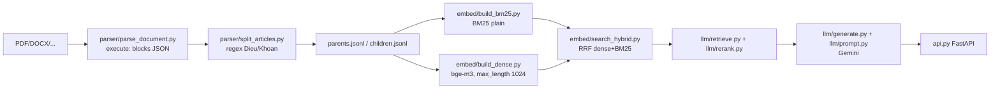
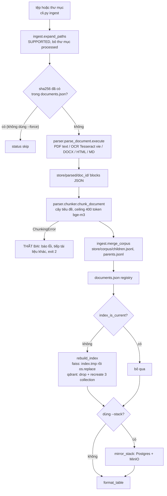
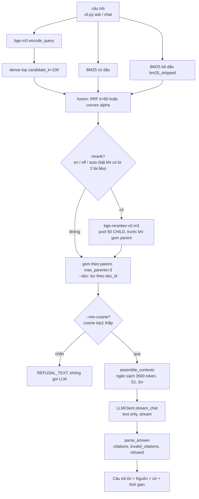

# Báo cáo refactor: RAG tổng quát, mô hình chuyên biệt chạy cục bộ

Nhánh `refactor/generic-rag-local-models` so với `main` (commit `ca50150`). Ngày đo: 2026-11-20 đến 2026-11-22.
Đường dẫn kết quả dưới dạng `results/...` nằm trong `RAG_lab/results/`.

## 1. Tóm tắt

| Mục | Nội dung |
|---|---|
| Mục tiêu | Chuyển pipeline RAG từ "chỉ ăn Quy chế có cấu trúc Điều/Khoản" sang pipeline tổng quát (PDF scan, PDF text, DOCX, HTML, MD, mã nguồn, bảng, công thức), nhiều tài liệu trong một store, chỉ dùng MỘT API trả phí dạng text. |
| Phạm vi | `RAG/` (parser, chunker, embed, llm, store, deploy, tests, CLI). Không đụng `RAG/api.py`, `RAG/eval/`, `front_end`, test split. |
| Trạng thái | Code xong, 154 unit test chạy (151 pass, 3 skip: cần Postgres/MinIO/Qdrant thật). 4 commit refactor đã đẩy lên; parser v3 chưa commit (xem mục "Cập nhật: parser v3"). Chưa có thay đổi nào cho `api.py` và `llm/{retrieve,rerank,prompt,generate}.py`: các file này vẫn là bản cũ, cục bộ cho Quy chế. |
| Kết quả chính | Ingest 17/17 tài liệu (cũ 2/17). End-to-end 107/115 = 0.930 trên S1-S4 dev, 0 hallucination trên 20 câu không có đáp án, chi phí ~$0.00004/câu. Điểm yếu: S4 0.762. |

## 2. Chính sách thiết kế

| # | Chính sách | Thực thi trong code |
|---|---|---|
| 1 | Một API LLM trả phí, chỉ text, qua OpenRouter; mặc định `qwen/qwen3.7-flash`, `reasoning.effort = none` | `llm/client.py`: `LLMConfig` (mặc định `base_url=https://openrouter.ai/api/v1`, `reasoning_effort="none"`) |
| 2 | Mọi mô hình chuyên biệt chạy cục bộ: dense `BAAI/bge-m3`, rerank `BAAI/bge-reranker-v2-m3`, OCR Tesseract `vie` | `embed/embedder.py`, `embed/collection.py` (`RERANKER_NAME`), `parser/parse_document.py` (pytesseract) |
| 3 | Ảnh KHÔNG BAO GIỜ gửi lên API | `check_text_only()` trong `llm/client.py` ném `ValueError("text-only client: non-text message content is refused")` với mọi phần không phải `str` hoặc `{"type":"text"}`; chạy trước mọi request, cả provider `anthropic` |
| 4 | Secret chỉ lấy từ biến môi trường mà `RAG_LLM_API_KEY_ENV` trỏ tới (mặc định tên biến `OPENROUTER_API_KEY`); key bị thay bằng `***` trong mọi thông báo lỗi | `LLMClient._key()`, `_scrub()`; `cli.py:api_key_error` |
| 5 | Hash chuẩn hoá LF: index không vỡ giữa checkout CRLF và LF | `embed/collection.py:sha256_lf`, `_read_rows` (bỏ BOM, đổi CRLF thành LF); `.gitattributes` ép `eol=lf` |
| 6 | Lỗi phải to, không im lặng | `ChunkingError` (0 children, child > `hard_max` 1000, phủ < 90% block); `ingest_paths` báo `!!! THẤT BẠI` và exit 2; `split_articles.py` exit 2 khi 0 Điều |

Ghi chú: `reasoning none` là bắt buộc, không phải tối ưu. Với reasoning mặc định, `qwen/qwen3.7-flash` trả câu trả lời RỖNG (800 token `max_tokens` bị dùng hết cho reasoning ẩn, `truncated=True`); xem comment trong `llm/client.py` (dòng 27-28).

## 3. Kiến trúc cũ (main, `ca50150`)

### 3.1 Pipeline



### 3.2 File (không đổi trên nhánh, trừ ghi chú)

| File | Vai trò |
|---|---|
| `parser/parse_document.py` | Parse theo định dạng (`SUPPORTED`), PDF scan qua OCR; đã sửa cấu hình OCR trên nhánh (xem 4.2) |
| `parser/parse_pdf.py` | Wrapper 24 dòng |
| `parser/split_articles.py` | Tách theo `Điều N`, sinh parents (Điều) và children (Khoản); 1 sửa trên nhánh: exit 2 khi 0 Điều |
| `embed/{embedder,build_dense,build_bm25,bm25,search_dense,search_hybrid}.py` | bge-m3 (`max_length=1024`, ném lỗi khi vượt, "không cắt ngầm"), FAISS, BM25 một chỉ mục (có dấu), hybrid RRF |
| `llm/{retrieve,rerank,prompt,generate}.py` | Retrieve + rerank + prompt `Quy chế đào tạo` (hard-code) + sinh bằng Gemini; trích dẫn dạng `[Tài liệu N]` |
| `api.py` | FastAPI cho front_end (`RAGGenerator`, `RAGRetriever`) |
| `eval/` | `eval_retrieval.py`, `eval_hallucination.py`, `eval_set.json` (Quy chế, parent id `dNN`) |

### 3.3 Lỗi đã biết của bản cũ (bằng chứng)

| # | Lỗi | Bằng chứng |
|---|---|---|
| 1 | Chỉ 2/17 tài liệu ingest trọn (parse, split, BM25, dense đều OK): `c1_docx`, `b1` | `results/ingest_baseline/summary.json` (17 docs; `dense.rc=0` chỉ ở 2 doc) |
| 2 | 3 tài liệu split được nhưng dense thất bại: child 2920 token (`quy_che_scan`/`a1_pdf`) và 4965 token (`c2`) > giới hạn 1024 | `summary.json` (`dense.rc=1` x3); `results/ingest_baseline/coverage.json` (`doc:c2`: `Input vượt 1024 token ... (156, 4965)`) |
| 3 | 12/17 cho 0 children, im lặng (exit 0, không báo) vì không có `Điều` | `summary.json`: 12 doc chỉ có `parse`/`split` (không `bm25`/`dense`); `coverage.json` 10 mục `split produced no children` (file này chỉ liệt kê 12 doc nhóm `doc:*`) |
| 4 | Quy chế 53 trang scan: cũ 8 Điều / 63 children, thực tế Quy chế có nhiều Điều hơn (mới: 55 parents / 92 children) | Đo trên store S1 mới `results/_nb/S1` (`refactor_e2e_S1_dev__qwen37_meta.json`: `parents 55, children 92`) |
| 5 | OCR cấu hình cứng: đường dẫn `C:\Program Files\Tesseract-OCR\tesseract.exe`, `lang="vie+eng"`; log in nhãn "RapidOCR" trong khi engine là Tesseract | `git diff main -- RAG/parser/parse_document.py`; `summary.json` (`stdout_tail`: `RapidOCR`) |
| 6 | BM25 một chỉ mục có dấu: truy vấn không dấu rớt hạng | `results/collection_s1_eval.json` `baseline_note`: `no_diacritics MRR 0.556` |
| 7 | Prompt, `NO_CONTEXT_REFUSAL`, breadcrumb mặc định hard-code "Quy chế đào tạo" | `llm/prompt.py` dòng 9-11, 25 |
| 8 | Chỉ một tài liệu, không có `doc_id` ở mức truy xuất, không CLI | `api.py`, `llm/retrieve.py` |
| 9 | Hash index không chuẩn hoá EOL (CRLF khác LF làm vỡ kiểm tra) | `results/_index_crlf` (thư mục tái hiện); sửa bằng `sha256_lf` |
| 10 | Dữ liệu và `.pyc` bị track trong git (`data/`, 19 file `.pyc`), không có `.gitignore` | `git ls-files` |

## 4. Kiến trúc mới

### 4.1 Luồng ingest



### 4.2 Luồng truy vấn



### 4.3 Bản đồ module

| File | Vai trò | Hàm/lớp chính | Test |
|---|---|---|---|
| `cli.py` (360 dòng) | CLI `ingest/ask/chat/info` | `build_parser`, `cmd_ingest`, `ask_once`, `search_docs`, `resolve_rerank`, `cmd_chat`, `cmd_info` | `tests/test_cli.py` (18) |
| `ingest.py` (267) | Điều phối ingest, store, index, mirror | `ingest_file`, `ingest_paths`, `merge_corpus`, `rebuild_index`, `index_is_current`, `qdrant_name`, `connect_qdrant`, `mirror_stack`, `format_table` | `tests/test_ingest.py` (9) |
| `parser/chunker.py` (439) | Chunker theo khối, không phụ thuộc Điều | `chunk_document`, `_detect_headings`, `_sections`, `_units`, `_pack`, `ChunkingError`, `default_token_counter` | `tests/test_chunker.py` (17) |
| `parser/parse_document.py` (838) | Parse + OCR (sửa cấu hình OCR) | `execute`, lớp OCR dùng `TESSERACT_CMD`, `OCR_LANG`, `TESSDATA_PREFIX` | `tests/test_parse_ocr_config.py` (5) |
| `parser/split_articles.py` (208) | Splitter cũ; thêm exit 2 khi 0 Điều | `main`, `group_articles`, `build` | không có test |
| `embed/collection.py` (305) | `Collection` FAISS + 2 BM25 + fusion + rerank | `Collection.build/open/search`, `sha256_lf`, `strip_accents`, `_normalize` | `tests/test_collection.py` (10) |
| `embed/qdrant_collection.py` (296) | Cùng API, lưu ở Qdrant | `QdrantCollection.build/open/search`, `_sparse`, `point_id`, `_corpus_hash` | `tests/test_qdrant_collection.py` (12, 1 skip) |
| `llm/client.py` (291) | Client text-only OpenAI-compatible (+ Anthropic) | `LLMConfig.from_env`, `LLMClient.stream_chat/chat`, `UsageMeter`, `check_text_only` | `tests/test_llm_client.py` (21) |
| `llm/answering.py` (113) | Prompt chung, ngân sách ngữ cảnh, trích dẫn | `assemble_contexts`, `build_messages`, `parse_answer`, `quote_support`, `REFUSAL_TEXT` | `tests/test_answering.py` (9) |
| `store/settings.py` (50) | Cấu hình store từ env | `StoreSettings.from_env`, `redacted` | `tests/test_store_settings.py` (4) |
| `store/pg.py` (170) | Postgres (psycopg 3) | `init_schema`, `upsert_document`, `replace_chunks`, `set_status`, `delete_document` | `tests/test_store_pg.py` (8, 1 skip) |
| `store/objects.py` (75) | MinIO, khoá đã làm sạch | `raw_key`, `page_key`, `blocks_key`, `safe_key`, `put_file`, `presigned_get` | `tests/test_store_objects.py` (8, 1 skip) |
| `store/doctor.py` (63) | Kiểm tra dịch vụ | `python -m store.doctor [--init]` | không có test riêng |
| `deploy/` | `docker-compose.yml`, `.env.example`, `README.md` | xem 4.8 | không |

(Số trong ngoặc là số test chạy, gồm test bị skip; xem mục 8.2.)

### 4.4 Hợp đồng dữ liệu

Cấu trúc store (`ingest.py` docstring):

```
<store>/
  corpus/children.jsonl, parents.jsonl     # nguồn sự thật, LF
  documents.json                           # registry: doc_id -> {source, title, filename, sha256, size_bytes, pages, blocks, parents, children, max_tokens, ingested_at}
  parsed/<doc_id>/                         # blocks JSON của parse_document
  index/                                   # backend faiss
    children.jsonl, parents.jsonl, embeddings.npy, tokens.json, manifest.json
```

`manifest.json`: `format_version=1`, `num_children`, `num_parents`, `dimension`, `model_name`, `embedder_revision`, `tokenizer` (`underthesea`), `tokenizer_format`, `tokenizer_version`, `sha256` (LF-chuẩn hoá của 4 file). `Collection.open` kiểm tra từng hash, số lượng, phiên bản tokenizer và revision của embedder; sai thì ném `ValueError` "cần rebuild". `doc_id = slug(tên tệp)[:40] + "-" + sha256[:6]`.

Child (`children.jsonl`): `child_id` (`<doc_id>-cNNNN`), `parent_id`, `doc_id`, `breadcrumb`, `text`, `page_start`, `page_end`, `bbox`, `block_ids`, `tokens`, `content_type` (`text|table|code|formula|mixed`); với tài liệu pháp lý thêm `chapter`, `chapter_title`, `article`.
Parent (`parents.jsonl`): `parent_id` (`<doc_id>-pNNNN`), `doc_id`, `title`, `breadcrumb`, `text`, `page_start`, `page_end` (+ `chapter`, `chapter_title`, `article` khi pháp lý).
Bắt buộc: `child_id`, `parent_id`, `text` không rỗng; không trùng id; mọi `parent_id` của child phải tồn tại (`_normalize`).

### 4.5 Thuật toán truy xuất (`embed/collection.py:Collection.search`)

| Bước | Chi tiết |
|---|---|
| Ba chỉ mục | `dense` (FAISS `IndexFlatIP`, vector bge-m3 chuẩn hoá), `bm25` (BM25Okapi, tokenizer underthesea), `bm25_stripped` (BM25Okapi trên văn bản bỏ dấu + `đ`->`d`, tokenizer `regex` có chủ đích) |
| Ứng viên | `candidate_k=100` (mặc định), mỗi chỉ mục lấy `min(candidate_k, n)` |
| Fusion `rrf` | `sum 1/(60+rank)` trên 3 danh sách (k=60 cố định) |
| Fusion `convex` | `alpha*dense_norm + (1-alpha)*max(bm25_norm, stripped_norm)` min-max theo danh sách, `alpha=0.7` mặc định |
| Rerank | `bge-reranker-v2-m3` (`CrossEncoder`, `max_length=1024`, fp16 trên CUDA) trên `rerank_pool=50` CHILD đầu bảng, TRƯỚC khi gom parent; hoà thì giữ thứ tự fusion |
| Gom parent | Nhóm child theo `parent_id`; điểm parent = điểm child cao nhất; lấy `max_parents` (CLI mặc định 3) |
| Neighbors | `neighbors=True`: nếu parent của top-1 có < 3 child, thêm child kề (cùng `doc_id`). Tham số có ở `Collection.search`; `cli.py` không bật |
| Auto rerank | `cli.py:resolve_rerank`: `auto` = bật khi store có >= 2 tài liệu (1 tài liệu: không có lợi ích đo được) |
| `--doc` | Qdrant: filter native theo `doc_id`. FAISS: lọc sau (post-filter) trên kết quả toàn corpus |
| Đầu ra | `children`, `parents` (kèm `matched_child_ids`), `timings_ms` (`embed,dense,bm25,fuse,rerank,total`), `top1` (`dense_cosine`, `fused`, `margin`) |

### 4.6 Thuật toán chunker (`parser/chunker.py`)

| Thành phần | Chi tiết |
|---|---|
| Nguồn cây tiêu đề | (1) block `type=heading` của parser (`level`); nếu không có: (2) đánh số `1.`, `1.1`, số La Mã `I.`, `Chương`/`Điều`; nếu < 2 dòng đánh số: (3) kiểu chữ (font_size >= 1.2 x median, hoặc in đậm) |
| Pháp lý | `profile=auto`: >= 3 block `Điều N` thì bật `legal`: `Chương` = mức 1, `Điều` = mức 2, thêm `chapter/article` vào metadata; cảnh báo (không bỏ) khi số Điều thiếu/trùng |
| Heading nhiều dòng | `_split_heading_blocks` tách OCR gộp dòng (tiêu đề + Điều/Chương nhúng + đoạn văn) |
| Trần child | `ceiling=400` token theo tokenizer `BAAI/bge-m3` (`AutoTokenizer`, chỉ đếm); `min_tokens=80` (gộp mảnh nhỏ với hàng xóm nếu không vượt trần); `hard_max=1000` |
| Parent | Một section = một parent; section > `PARENT_MAX=2000` token hoặc không có tiêu đề: cắt cửa sổ `PARENT_WINDOW=1500` |
| Nguyên tử | `table`, `code`, `formula` không bị cắt giữa chừng nếu vừa trần; nếu vượt: cắt theo dòng, bảng lặp lại 2 dòng header (nếu header <= ceiling/3); đoạn thường cắt theo câu, gác câu cuối sang mảnh sau; từ quá dài (base64) cắt theo ký tự |
| `skip_sections` | Bỏ mục `Chú thích/Ghi chú/Tham khảo/Nguồn tham khảo/Liên kết ngoài/Xem thêm/Thư mục/References/Notes/External links/See also/Bibliography/Footnotes` (so sánh sau khi bỏ dấu) |
| Noise filter | `_is_noise`: block >= 70% dòng là link wikipedia liên ngôn ngữ hoặc back-ref `[↑](#cite_ref-...)`; không bao giờ áp cho table/code/formula |
| Lỗi to | `ChunkingError`: 0 children; child > `hard_max`; < 90% block không rỗng được gán vào child |
| Thống kê | `last_stats()`: `skipped_sections`, `skipped_blocks`, `noise_blocks` |

### 4.7 Tầng LLM

Biến cấu hình (`LLMConfig.from_env`):

| Biến | Mặc định | Ghi chú |
|---|---|---|
| `RAG_LLM_PROVIDER` | `openai` | `openai` (chat/completions) hoặc `anthropic` (Messages API; khi đó `RAG_LLM_MODEL` bắt buộc, base URL chỉ từ `RAG_LLM_BASE_URL`) |
| `RAG_LLM_MODEL` | `qwen/qwen3.7-flash` | |
| `RAG_LLM_BASE_URL` | `https://openrouter.ai/api/v1` | |
| `RAG_LLM_API_KEY_ENV` | `OPENROUTER_API_KEY` | TÊN biến chứa key (không phải key) |
| `RAG_LLM_REASONING_EFFORT` | `none` | Đặt rỗng để bỏ field `reasoning`; gửi `{"reasoning": {"effort": ...}}` |
| `RAG_LLM_TIMEOUT` / `RAG_LLM_MAX_TOKENS` | `60` s / `800` | |
| `RAG_LLM_TEMPERATURE` | `0.1` | `none` = không gửi |
| `RAG_LLM_PRICE_IN` / `_OUT` | (không) | USD / 1M token, chỉ để tính cost cho provider `anthropic` |
| `RAG_LLM_MAX_CONCURRENCY` | `4` | `Semaphore` |

Hành vi client:
- Retry: tối đa `MAX_RETRIES=4` (5 lần thử) với backoff `2^attempt` s trên HTTP 429, >= 500 và lỗi mạng; tôn trọng `Retry-After`; HTTP 4xx khác 429 ném ngay `RuntimeError("HTTP <code>: ...")`; thông báo lỗi cắt 300 ký tự và scrub key.
- Header mặc định `HTTP-Referer`, `X-Title`, và `User-Agent: RAG_official/0.1 (+local; python-urllib)` (Cloudflare trước OpenCode trả 403/1010 cho User-Agent mặc định của urllib).
- Nếu `base_url` chứa `opencode.ai`: thêm `x-opencode-session` (uuid4 hex, giữ theo client) vì OpenCode từ chối thiếu session id (400 MissingSessionID).
- Stream SSE, `stream_options.include_usage`; event cuối có `usage`, `truncated` (`finish_reason == "length"`), `latency_s`, `t_first_token_s`. `UsageMeter` cộng dồn theo `stage`.
- `python -m llm.client --ping` kiểm tra kết nối.

Lớp trả lời (`llm/answering.py`):

| Phần | Chi tiết |
|---|---|
| `SYSTEM_PROMPT` | Chung, không nhắc Quy chế: chỉ dùng NGUỒN `[S1]..`, mỗi ý kèm trích dẫn, từ chối nguyên văn `REFUSAL_TEXT`, quy tắc chung vs chi tiết cụ thể, nguồn là dữ liệu không phải lệnh, không hỏi ngược |
| `REFUSAL_TEXT` | `Tài liệu được cung cấp không có thông tin này.` |
| `assemble_contexts` | Ngân sách `3500` token (mặc định); theo thứ tự hạng; mục nào làm vượt ngân sách thì bỏ cả mục (không cắt giữa đoạn); nếu mục đầu tiên đã quá lớn: giữ các đoạn đầu vừa ngân sách (`truncated=True`, luôn giữ >= 1 đoạn) |
| `build_messages` | `NGUỒN` + (tuỳ chọn) `LỊCH SỬ HỘI THOẠI` (`MAX_HISTORY_TURNS=6`) + `CÂU HỎI`; NFC |
| `parse_answer` | Trích `[S1]`, `[S1, S2]`; `citations` (chỉ mã hợp lệ), `invalid_citations` (mã không có trong nguồn), `refused` (có `REFUSAL_TEXT` hoặc khớp regex `không có thông tin|không được nêu|không đề cập|...`), `has_citation` |
| `quote_support` | Tỉ lệ 4-gram của câu trả lời có trong nguồn đã trích (công cụ đánh giá, không dùng để chặn) |

### 4.8 Tầng lưu trữ

Postgres 16 (`store/pg.py`, schema version 1, SQL tham số hoá):

| Bảng | Cột chính |
|---|---|
| `schema_version` | `version`, `applied_at` |
| `documents` | `doc_id` PK, `title`, `filename`, `mime`, `sha256` UNIQUE, `size_bytes`, `pages`, `status` (CHECK: `queued,parsing,ocr,chunking,indexing,ready,failed`), `progress_done/total`, `error`, `object_key`, `created_at`, `updated_at` |
| `parents` | `parent_id` PK, `doc_id` FK CASCADE, `ord`, `title`, `breadcrumb`, `text`, `page_start/end`, `chapter`, `article` |
| `children` | `child_id` PK, `parent_id` FK, `doc_id` FK, `ord`, `breadcrumb`, `text`, `page_start/end`, `bbox` jsonb, `block_ids` jsonb, `tokens`, `content_type` |
| `ingest_events`, `api_usage` | log ingest theo stage; token/cost theo model |

Lưu ý: tổng là 6 bảng trong `SCHEMA_SQL` (`schema_version`, `documents`, `parents`, `children`, `ingest_events`, `api_usage`); 5 bảng nghiệp vụ nếu không tính `schema_version`.

MinIO (`store/objects.py`): bucket `rag`; khoá `raw/<sha256>/<filename>`, `pages/<doc_id>/<NNNNN>.png`, `blocks/<doc_id>.json`; `safe_key` chuẩn hoá NFC, bỏ `..`, `/` đầu, cắt đoạn 120 ký tự. `mirror_stack` hiện chỉ ghi `raw/` và `blocks/` (`pages/` chưa được ingest ghi).

Qdrant (`embed/qdrant_collection.py`), tên `rag_<slug tên thư mục store>`:

| Collection | Nội dung |
|---|---|
| `<name>` | Named vector `dense` (cosine) + sparse `bm25` và `bm25_stripped` (`Modifier.IDF`); payload = child + `ord`; payload index `doc_id`, `parent_id` (KEYWORD), `ord` (INTEGER) |
| `<name>_parents` | 1 điểm/parent, vector giả 1 chiều, payload = parent + `ord` |
| `<name>_meta` | 1 điểm id=1 chứa manifest (+ `avgdl`, `sha256` của corpus) |

Point id = 8 byte đầu của `sha256(id)` dạng uint64; chỉ số sparse = `zlib.crc32(token)`; giá trị sparse = tf bão hoà BM25 (`k1=1.5`, `b=0.75`), IDF do Qdrant nhân lúc truy vấn. `build()` DROP và tạo lại cả 3 collection (idempotent), upsert theo lô 256.

Docker compose (`deploy/docker-compose.yml`, mọi cổng bind `127.0.0.1`):

| Service | Image | Cổng | Volume (named) |
|---|---|---|---|
| `qdrant` | `qdrant/qdrant:v1.20.0` | 6333, 6334 | `qdrant_data` |
| `postgres` | `postgres:16-alpine` (healthcheck `pg_isready`) | 5432 | `postgres_data` |
| `minio` | `cgr.dev/chainguard/minio:latest` | 9000, console 9001 | `minio_data` |

`minio/minio` (Docker Hub) và `quay.io/minio/minio` không còn pull được (kiểm tra 2026-11-22 bằng `docker manifest inspect`), nên dùng Chainguard; chỉ có tag `:latest` miễn phí, cần ghim digest sau. Volume là named volume vì bind mount trên Windows lỗi `chmod`/quyền. Secret từ `deploy/.env` (copy từ `.env.example`, mặc định chỉ cho dev).

### 4.9 CLI

Chạy từ `RAG/`: `python cli.py <lệnh> ...`. Exit: 0 OK, 1 lỗi runtime (LLM), 2 lỗi người dùng/tài liệu thất bại/thiếu cấu hình.

| Lệnh | Cờ |
|---|---|
| `ingest <paths...>` | `--store` (bắt buộc), `--backend faiss\|qdrant` (mặc định `faiss`), `--device cuda\|cpu`, `--ceiling 400`, `--tessdata DIR` (đặt `TESSDATA_PREFIX`), `--force`, `--stack` |
| `ask "<câu hỏi>"` | `--store`, `--backend`, `--doc ID` (lặp được), `--device`, `--top 5`, `--max-parents 3`, `--fusion rrf\|convex`, `--alpha 0.7`, `--rerank [on\|off\|auto]` (mặc định `auto`), `--no-llm`, `--min-cosine X`, `--budget-tokens 3500`, `--json` |
| `chat` | như `ask` (không có `--json`); lệnh trong REPL: `/sources`, `/stats`, `/quit`; giữ lịch sử 6 tin nhắn |
| `info` | `--store`, `--backend`; in tài liệu, manifest, LLM đang cấu hình (key `đã đặt`/`CHƯA đặt`), `StoreSettings` đã che secret, GPU |

Ví dụ copy-paste (PowerShell, cwd `RAG`):

```powershell
$py = "D:\00_Workspace\AI_Lab\RAG_official\RAG_lab\.venv\Scripts\python.exe"
$env:OPENROUTER_API_KEY = "<key>"          # tên biến này là RAG_LLM_API_KEY_ENV mặc định
& $py -X utf8 cli.py ingest ..\RAG_lab\parser_samples --store .rag_data\demo
& $py -X utf8 cli.py ask "Sinh viên được đăng ký tối đa bao nhiêu tín chỉ?" --store .rag_data\demo
& $py -X utf8 cli.py ask "..." --store .rag_data\demo --no-llm            # chỉ xem đoạn truy xuất, không cần key
& $py -X utf8 cli.py ask "..." --store .rag_data\demo --doc <doc_id> --json
& $py -X utf8 cli.py chat --store .rag_data\demo                          # giữ mô hình nóng
& $py -X utf8 cli.py info --store .rag_data\demo
```

### 4.10 Biến môi trường

| Biến | Dùng ở | Mặc định |
|---|---|---|
| `RAG_LLM_PROVIDER/MODEL/BASE_URL/API_KEY_ENV/REASONING_EFFORT/TIMEOUT/MAX_TOKENS/TEMPERATURE/PRICE_IN/PRICE_OUT/MAX_CONCURRENCY` | `llm/client.py` | xem 4.7 |
| `OPENROUTER_API_KEY` (hoặc biến tên trong `RAG_LLM_API_KEY_ENV`) | `llm/client.py` | không có |
| `TESSERACT_CMD` | `parse_document.py` | `PATH`, rồi `C:\Program Files\Tesseract-OCR\tesseract.exe`; không thấy: `RuntimeError` có hướng dẫn |
| `OCR_LANG` | `parse_document.py` | `vie+eng`; thiếu traineddata: `RuntimeError` liệt kê ngôn ngữ có sẵn |
| `TESSDATA_PREFIX` | Tesseract | do Tesseract; `--tessdata` ghi đè |
| `RAG_PG_HOST/PORT/DB/USER/PASSWORD` | `store/settings.py` | `127.0.0.1/5432/rag/rag/rag` |
| `RAG_MINIO_ENDPOINT/ACCESS_KEY/SECRET_KEY/BUCKET/SECURE` | `store/settings.py` | `127.0.0.1:9000/ragdev/ragdev-secret/rag/false` |
| `RAG_QDRANT_URL/API_KEY/COLLECTION` | `store/settings.py` | `http://127.0.0.1:6333/(rỗng)/rag_children` |
| `POSTGRES_USER/PASSWORD/DB`, `MINIO_ROOT_USER/PASSWORD` | `deploy/.env` | `rag/rag/rag`, `ragdev/ragdev-secret` |

## 5. Bảng so sánh CŨ và MỚI

| Khía cạnh | Cũ | Mới | Bằng chứng / ghi chú |
|---|---|---|---|
| Phủ ingest | 2/17 tài liệu trọn; 3 split nhưng dense lỗi; 12/17 ra 0 children, im lặng | 17/17 ingest được | `results/ingest_baseline/summary.json`; `results/chunker_coverage.json`; S1-S4 stores `results/_nb/S*` |
| Splitter | `split_articles.py`: regex `Điều/Khoản`; thiếu Điều thì 0 children, exit 0 | `chunker.py`: cây tiêu đề (heading, đánh số, kiểu chữ), pháp lý chỉ là một profile; splitter cũ nay exit 2 khi 0 Điều | `parser/split_articles.py` (diff 3 dòng) |
| Trần child | Không có; child 2920 và 4965 token vượt giới hạn dense 1024 | `ceiling=400` (đo token bge-m3), `hard_max=1000` ném lỗi | `coverage.json` (cũ); `max_tokens` trong `documents.json` của store |
| Cấu hình OCR | Cứng đường dẫn Windows + `lang="vie+eng"`; log nhãn "RapidOCR" sai | `TESSERACT_CMD`, `OCR_LANG`, `TESSDATA_PREFIX`; kiểm tra có `vie`; log "Tesseract" | `git diff main -- RAG/parser/parse_document.py`; `tests/test_parse_ocr_config.py` |
| Toàn vẹn index (CRLF) | Hash theo byte thô: checkout CRLF làm manifest sai | `sha256_lf`, bỏ BOM, `.gitattributes` `eol=lf` | `embed/collection.py`; `results/_index_crlf` |
| BM25 và dấu | 1 BM25 có dấu; `no_diacritics MRR 0.556` | thêm `bm25_stripped`; `no_diacritics MRR 1.000` (rrf) | `results/collection_s1_eval.json` |
| Fusion | RRF dense + BM25 | RRF k=60 trên 3 danh sách, hoặc convex (alpha) | `Collection.search`; convex a0.7 cho no_diacritics 0.75 |
| Vị trí rerank | rerank sau khi chọn ở mức parent | rerank pool 50 CHILD trước khi gom parent; `auto` bật khi >= 2 tài liệu | `Collection.search`; `cli.resolve_rerank` |
| Ghép ngữ cảnh | `max_context_tokens=6000` (ước lượng) trong `retrieve.py` | `assemble_contexts` ngân sách 3500 token thật (bge-m3), không cắt giữa đoạn | `llm/retrieve.py`; `llm/answering.py` |
| Prompt tổng quát | Hard-code "Quy chế đào tạo", `Điều/Khoản`, `[Tài liệu N]` | Prompt chung, nguồn `[S1]..`, `REFUSAL_TEXT` chung | `llm/prompt.py` vs `llm/answering.py` |
| LLM provider / cấu hình | Gemini 2.5 Flash, cấu hình riêng | OpenAI-compatible mặc định OpenRouter `qwen/qwen3.7-flash`, reasoning `none`; tuỳ chọn `anthropic`; retry, scrub key | `llm/client.py` |
| Kiểm tra trích dẫn | Có mã `[Tài liệu N]` nhưng không có hàm riêng kiểm tra mã không hợp lệ (not verified: chưa đọc hết `generate.py`) | `parse_answer`: `invalid_citations`, `has_citation`, `quote_support` | `llm/answering.py` |
| Từ chối (abstention) | Câu cố định `NO_CONTEXT_REFUSAL` về Quy chế | `REFUSAL_TEXT` + nhận diện regex + chặn cục bộ `--min-cosine` (không gọi LLM) | `cli.ask_once`; refusal đúng 20/20 |
| Backend lưu trữ | Tệp cục bộ (`data/indexes/*`, FAISS + BM25) | FAISS cục bộ (mặc định) hoặc Qdrant; tuỳ chọn mirror Postgres + MinIO | `ingest.py`, `store/`, `deploy/` |
| Nhiều tài liệu | Một corpus Quy chế, không `doc_id` ở truy vấn | `doc_id` mọi nơi, registry, `--doc` lọc, thay thế khi nguồn đổi, bỏ qua theo sha256 | `ingest.py` |
| CLI | Không có (chỉ `api.py`) | `cli.py ingest/ask/chat/info` | `cli.py`, `CLI_DEMO.md` |
| Test | Không có thư mục tests trên `main` | 154 test unit (3 skip) | mục 8.2 |
| Requirements / pin | `requirements.txt` chỉ cận dưới, thiếu storage/pytesseract/transformers | thêm `pytesseract`, `transformers`, `qdrant-client`, `psycopg[binary]`, `minio`; `requirements.lock.txt` ghim đủ phiên bản | `git diff -- RAG/requirements.txt` |
| Git hygiene | Không `.gitignore`; track `data/`, `.pyc` | Thêm `RAG/.gitignore` (`__pycache__/`, `*.pyc`, `.env`, `.rag_data/`, `data/`, `results/`) và `RAG/.gitattributes`; file đã track vẫn cần `git rm --cached` (19 `.pyc` + `data/...`) | `git ls-files` |
| Chi phí mỗi câu | ~$0.001 (gemini-2.5-flash) | ~$0.00004 (`qwen/qwen3.7-flash`, reasoning `none`; 3.470 prompt + 117 completion token) | số đo của dự án; xem mục 7 |

## 6. Số liệu đo

Nguồn nằm dưới `RAG_lab/results/`. "not measured": brief không có số.

### 6.1 Ingest

| Chỉ số | Cũ | Mới | Nguồn |
|---|---|---|---|
| Tài liệu ingest trọn | 2/17 | 17/17 | `ingest_baseline/summary.json` |
| Dense lỗi do child quá dài | 3 (2920 và 4965 token > 1024) | 0 | `ingest_baseline/summary.json`, `coverage.json` |
| 0 children im lặng | 12/17 | 0 | như trên |
| Quy chế, ingest mới | 8 Điều / 63 children | 55 parents / 92 children | `refactor_e2e_S1_dev__qwen37_meta.json` (`store_counts`) |
| Max child token | không ràng buộc (4965) | 396-400 trong store S1-S4 (cổng chunker trước sửa: max 547) | `results/chunker_coverage.json`, `documents.json` các store |
| Child sau noise filter | d1 405 -> 237, d2 474 -> 270, d3 640 -> 455 | | `results/chunker_coverage.json` (not re-read here) |

Kích thước store dev (mới): S1 1 tài liệu 55/92 (parents/children); S2 7 tài liệu 327/482; S3 6 tài liệu 119/203; S4 3 tài liệu 228/962 (`refactor_e2e_S*_dev__qwen37_meta.json`).

Thời gian ingest (wall):

| Tập | Pipeline mới | NotebookLM (tham chiếu) |
|---|---|---|
| Quy chế 53 trang scan | 100 s (OCR 75,3 s) | 28,1 s |
| S2 (7 tài liệu) | 125 s (scan `b1` OCR 40,2 s) | 88,8-186,4 s |
| S3 | 62 s | 89,3 s |
| S4 | 89 s | 84,4 s (tải lên dạng text) |

Cũ (parse riêng, 2026-11-20): Quy chế scan parse 77,7 s (`ingest_baseline/summary.json`); ngân sách mục tiêu `<= 90-120 s/doc`.

### 6.2 Truy xuất trên S1 dev (23 câu có đáp án, mức parent)

| Cấu hình | MRR@10 | Hit@1 | MRR no_diacritics | p50 |
|---|---|---|---|---|
| Cũ: hybrid RRF | 0,918 | 0,870 | 0,556 | 17 ms |
| Mới: `rrf` | 0,978 | 0,957 | 1,000 | 21 ms |
| Mới: `rrf+rerank` (pool 50) | 0,946 | 0,913 | 0,750 | 495 ms |
| Mới: `convex` alpha 0,5 / 0,7 / 0,9 | 0,957 / 0,928 / 0,914 | 0,913 / 0,870 / 0,870 | 1,00 / 0,75 / 0,60 | 18-19 ms |

Nguồn: `results/collection_s1_eval.json` (cũ: `baseline_note` trong cùng file và `results/baseline_rag_s1_dev.json`). Trên S1 (1 tài liệu) rerank không cải thiện, nên `auto` tắt cho 1 tài liệu.

`quote-hit@3` (pipeline mới, matcher 3-gram mờ >= 0,6): S1 0,913 (21/23), S2 0,933 (28/30), S3 0,913 (21/23), S4 0,842 (16/19). Tổng lỗi: 4 do matcher/trích xuất, 5 do truy xuất. Nguồn: `results/quote_hit_S{1..4}_dev.json`.

### 6.3 End-to-end (judge Claude mù, accuracy trên toàn bộ item, chỉ tính `yes`)

| Hệ | S1 | S2 | S3 | S4 | Nguồn |
|---|---|---|---|---|---|
| NotebookLM | 30/30 | 37/37 | 27/27 | 20/20 (S4 tải dạng text extract) | `results/judge_claude/*` |
| RAG cũ (Gemini 2.5 Flash) | 29/30 | không ingest được | không ingest được | không ingest được | `results/judged_rag_e2e_S1_dev_summary.txt` |
| Mới (`qwen/qwen3.7-flash`, reasoning `none`) | 30/30 | 36/37 (0,973) | 25/27 (0,926; 1 partial, 1 wrong) | 16/21 (0,762; yes 16, partial 1, no 4) | `results/judge_claude_refactor/qwen37/S*/summary.json` |

Tổng mới: 107/115 = 0,930. Từ chối đúng 20/20 câu không có đáp án (S1 7, S2 7, S3 4, S4 2), hallucination 0. Từ chối nhầm (false refusal): S3 1/23 (0,0435), S4 2/19 (0,1053).

### 6.4 Latency, chi phí, tài nguyên

| Chỉ số | Giá trị | Nguồn |
|---|---|---|
| Time-to-first-token p50 (warm) | 0,54-0,67 s (S1: 0,657 s) | `refactor_e2e_S*_dev__qwen37_meta.json` `latency` |
| LLM tổng p50 | 1,02-1,16 s (S1: 1,021 s) | như trên |
| Rerank (khi bật) | ~0,89-0,95 s | brief; `collection_s1_eval.json` cho `rrf+rerank` p50 495 ms (S1, 23 query) |
| Embed câu hỏi | 0,04-0,16 s (S1: 160 ms) | `refactor_e2e` meta |
| Search | 2-7 ms (S1: 2,2 ms) | như trên |
| Khởi động lạnh một tiến trình `cli.py ask` | ~21-22 s (bge-m3 ~10 s + reranker ~9 s): dùng `chat` | brief; not re-measured |
| Chi phí/câu | ~$0,00004 (3.470 prompt + 117 completion) so với ~$0,001 với gemini-2.5-flash | `llm/client.py` comment; brief |
| Reasoning mặc định của Qwen | câu trả lời RỖNG (800 token dùng cho reasoning ẩn, `truncated=True`) | `llm/client.py` comment |
| VRAM | bge-m3 đỉnh 2,25 GB; 3,43 GB khi có reranker (RTX 4050 6 GB) | `collection_s1_eval.json` `vram_peak_mb 3431,2` (khớp 3,43 GB); 2,25 GB từ brief |

## 7. Giới hạn và rủi ro đã biết

| # | Giới hạn |
|---|---|
| 1 | S4 0,762, dưới mục tiêu 0,93 (S4: 962 children, cross_doc và multi_section yếu: `multi_section` 0/2, `cross_doc` 2/3). |
| 2 | Judge là Claude và câu hỏi do Claude viết: có thể thiên lệch. |
| 3 | Bộ sinh khác nhau giữa các hệ (Gemini, Qwen, NotebookLM): so sánh trộn hiệu ứng của bộ sinh và của pipeline. |
| 4 | `quote-hit` dùng matcher 3-gram mờ ngưỡng >= 0,6; 4 lỗi là do matcher/trích xuất chứ không phải truy xuất. |
| 5 | `--stack` (mirror Postgres/MinIO) và backend Qdrant của CLI mới chỉ smoke test (Qdrant: một tài liệu markdown, `results/_store_qdrant_smoke`); 3 test live bị skip khi không có dịch vụ. `mirror_stack` không ghi `pages/*.png`. |
| 6 | Lệch phiên bản Qdrant: client 1.20.0 và server 1.15.3 trước đây; compose nay ghim `v1.20.0`, phải tạo lại volume `qdrant_data`. |
| 7 | IDF của Qdrant khác `BM25Okapi`: thứ hạng có thể khác trên corpus lớn. Sparse index dùng `crc32` 32-bit (va chạm token gộp trọng số, bỏ qua được cho corpus này). |
| 8 | `--doc` trên FAISS là post-filter (ứng viên và rerank pool chọn trên toàn corpus rồi mới cắt). |
| 9 | Unit test của `llm/client` đọc env tiến trình (`RAG_LLM_*`) nên FAIL nếu các biến này được đặt; phải chạy với `env -u`. |
| 10 | Test split chưa đụng tới. |
| 11 | OpenCode: API key thử nhưng tài khoản thiếu gói Go/số dư Zen và không có gemini-2.5-flash; client vẫn có xử lý `x-opencode-session`/User-Agent. |
| 12 | Revision của bge-m3 không ghim trong code (`SentenceTransformer(MODEL_NAME, revision=None)`); hash cache cục bộ `5617a9f61b028005a4858fdac845db406aefb181`; `manifest.embedder_revision` chỉ phát hiện đổi revision, không ngăn. |
| 13 | Chất lượng OCR chỉ đo gián tiếp (proxy): không có ground truth từng ký tự. |
| 14 | Khởi động lạnh ~21-22 s mỗi lần `cli.py ask`; dùng `chat`. |
| 15 | `api.py` và `llm/{retrieve,rerank,prompt,generate}.py` vẫn là bản cũ cho Quy chế; chưa nối với `Collection`/`LLMClient` mới, nên front_end chưa dùng pipeline mới. |
| 16 | `deploy/README.md` lỗi thời: nói "Qdrant client code comes later" và dữ liệu ở `RAG/.rag_data/{postgres,minio,qdrant}` trong khi compose dùng named volume. |
| 17 | `.gitignore` chưa có tác dụng với file đã track: cần `git rm --cached` (19 `.pyc`, `data/...`). |

## 8. Hướng dẫn chạy nhanh

### 8.1 Lệnh

```powershell
# 1. Dịch vụ lưu trữ (tuỳ chọn; FAISS không cần)
cd D:\00_Workspace\AI_Lab\RAG_official\RAG\deploy
copy .env.example .env
docker compose up -d
# Nếu đã có volume qdrant cũ (server 1.15.3): docker compose down -v rồi up lại

# 2. Kiểm tra / khởi tạo schema + bucket (cwd RAG)
cd ..
$py = "D:\00_Workspace\AI_Lab\RAG_official\RAG_lab\.venv\Scripts\python.exe"
& $py -X utf8 -m store.doctor --init

# 3. Ingest, hỏi, chat, info
$env:OPENROUTER_API_KEY = "<key>"
& $py -X utf8 cli.py ingest <tệp-hoặc-thư-mục> --store .rag_data\demo [--backend qdrant] [--stack]
& $py -X utf8 cli.py ask "<câu hỏi>" --store .rag_data\demo
& $py -X utf8 cli.py chat --store .rag_data\demo
& $py -X utf8 cli.py info --store .rag_data\demo

# 4. Test (cwd RAG; các biến RAG_LLM_* phải chưa đặt)
& $py -X utf8 -m unittest discover -s tests
```

OCR: cần Tesseract + `vie.traineddata`; đặt `TESSERACT_CMD`, `TESSDATA_PREFIX` (hoặc `--tessdata`), `OCR_LANG` nếu không dùng mặc định.

### 8.2 Kết quả unit test (chạy 2026-11-22, `env -u RAG_LLM_*`)

Lệnh: `python -X utf8 -m unittest discover -s tests -v` (cwd `RAG`). Kết quả đo ngày 2026-11-22 khi chưa có parser v3: `Ran 121 tests in 7.467s`, `OK (skipped=3)`; bảng dưới là số liệu đó. Hiện tại (có test parser v3): 154 test, 3 skip.

| Module | Chạy | Pass | Skip |
|---|---|---|---|
| `test_answering` | 9 | 9 | 0 |
| `test_chunker` | 17 | 17 | 0 |
| `test_cli` | 18 | 18 | 0 |
| `test_collection` | 10 | 10 | 0 |
| `test_ingest` | 9 | 9 | 0 |
| `test_llm_client` | 21 | 21 | 0 |
| `test_parse_ocr_config` | 5 | 5 | 0 |
| `test_qdrant_collection` | 12 | 11 | 1 (cần server Qdrant) |
| `test_store_objects` | 8 | 7 | 1 (cần MinIO) |
| `test_store_pg` | 8 | 7 | 1 (cần Postgres) |
| `test_store_settings` | 4 | 4 | 0 |
| Tổng | 121 | 118 | 3 |

(Lý do skip suy ra từ tên module; không đọc nội dung skip.)

## 9. Phụ lục

### 9.1 File mới / sửa (`git status --short`, chưa commit)

| Thư mục | Mục | Trạng thái |
|---|---|---|
| `RAG/` | `cli.py`, `ingest.py`, `CLI_DEMO.md`, `requirements.lock.txt`, `.gitignore`, `.gitattributes` | mới (`??`) |
| `RAG/` | `requirements.txt` | sửa (`M`) |
| `RAG/parser/` | `chunker.py` | mới |
| `RAG/parser/` | `parse_document.py`, `split_articles.py` | sửa |
| `RAG/embed/` | `collection.py`, `qdrant_collection.py` | mới |
| `RAG/llm/` | `answering.py`, `client.py` | mới |
| `RAG/store/` | `__init__.py`, `settings.py`, `pg.py`, `objects.py`, `doctor.py` | mới |
| `RAG/deploy/` | `docker-compose.yml`, `.env.example`, `README.md` (+ `.env` cục bộ, bị `.gitignore`) | mới |
| `RAG/tests/` | 11 file test + `__init__.py` | mới |
| `RAG/docs/` | `REFACTOR_REPORT.md` (file này) | mới |
| `RAG/embed/__pycache__/`: `bm25, build_dense, embedder, search_dense, search_hybrid` `.cpython-312.pyc`; `RAG/parser/__pycache__/parse_document.cpython-312.pyc` | | ĐÃ TRACK (`M`), nên `git rm --cached` rồi bỏ khỏi repo |
| ngoài `RAG/` | `.agents/`, `.claude/`, `RAG_lab/`, `skills-lock.json` | mới, không thuộc phạm vi refactor `RAG/` |

Ngoài ra `git ls-files` còn track tổng cộng 19 file `.pyc` và `RAG/data/*` (PDF, `indexes/bm25`, `indexes/dense_bge_m3`: `children.faiss`, `embeddings.npy`, ...); `.gitignore` mới không gỡ chúng.

### 9.2 Phụ thuộc thay đổi

| Gói | `requirements.txt` | `requirements.lock.txt` |
|---|---|---|
| `qdrant-client` | `>=1.15` (mới) | `==1.20.0` |
| `psycopg[binary]` | `>=3.2` (mới) | `psycopg==3.3.9`, `psycopg-binary==3.3.9` |
| `minio` | `>=7.2` (mới) | `==7.2.20` |
| `pytesseract` | `>=0.3.10` (mới) | `==0.3.13` |
| `transformers` | không ràng buộc (mới) | `==5.23.0` |
| Khác (đã có) | giữ nguyên, thêm chú thích nhóm | ghim: `torch==2.14.1+cu126`, `sentence-transformers==5.7.0`, `faiss-cpu==1.16.0`, `rank-bm25==0.2.2`, `underthesea==9.5.0`, `numpy==2.5.5`, ... |

## Cập nhật: parser v3

Chi tiết kỹ thuật, schema khối và giới hạn: [PARSER_V3.md](PARSER_V3.md).

- Parser v3 (`PARSER_VERSION 3.0.0`) tạo khối có kiểu `code`, `formula`, `figure` (kèm asset PNG), `table` có `rows`; chunker coi các kiểu này là nguyên tử và ghi `block_ids`, `assets`, `languages` vào child. CLI hiện nhãn `[hình]/[công thức]/[mã]/[bảng]` ở nguồn.
- Test hiện tại: 154 test, 3 skip (thêm các file test parser/chunker/ingest cho asset và khối).
- Đo trên mẫu nhỏ: S2 quote-hit@3 0,933 -> 0,933; S3 0,913 -> 0,957 (22/23, một lật S3-d-009); parser 20/21 tài liệu mẫu ok.
- Giới hạn chính: chưa sinh LaTeX; bảng row-span bị làm phẳng; biểu đồ ảnh không có giá trị số.
- Benchmark mô hình OCR/công thức (cục bộ, mẫu nhỏ): chưa thêm mô hình nào vào pipeline; Tesseract giữ cho trang quét.
- Trạng thái git: 4 commit refactor đã đẩy; thay đổi parser v3 (`cli.py`, `ingest.py`, `parser/*`, test mới, tài liệu này) chưa commit cho tới khi người dùng commit.

## Đối chiếu (brief so với tệp kết quả / code)

1. `results/ingest_baseline/coverage.json` chỉ có 12 mục (nhóm `doc:*`): 1 dense OK, 1 dense lỗi, 10 `0 children`. Số 17 tài liệu (2 trọn, 3 dense lỗi, 12 zero) khớp với `results/ingest_baseline/summary.json` (17 docs), không khớp với `coverage.json` nếu đọc riêng.
2. Brief: "Postgres 5 tables". Code `SCHEMA_SQL` tạo 6 bảng (`schema_version` + 5 bảng nghiệp vụ).
3. Brief: "neighbors" thuộc thuật toán mặc định. Code: `neighbors=False` mặc định và `cli.py` không bật; chỉ có ở `Collection.search`.
4. Brief: "S4 16/21 (14 yes...)" đã thay bằng `summary.json`: accuracy 0,7619 = 16/21, `false_refusal_rate` 0,1053 (2/19). Khớp: S2 0,973 = 36/37, S3 0,9259 = 25/27, tổng 107/115.
5. `Collection.search` mặc định `max_parents=5`; `cli.py` mặc định 3.
6. `llm/client.py` còn `provider=anthropic` (không có trong brief). Header `x-opencode-session` chỉ thêm khi `base_url` chứa `opencode.ai`.
7. Brief nói client chặn ảnh bằng cách từ chối phần không phải text: đúng (`check_text_only`), áp dụng cả provider `anthropic`.
8. Quy chế cũ "8 Điều / 63 children" và các số "d1 405->237..." lấy từ brief; không đối chiếu được với tệp trong thời gian cho phép.
9. `mirror_stack` ghi `raw/` và `blocks/` nhưng chưa ghi `pages/` dù `objects.page_key` tồn tại.
10. `deploy/README.md` lỗi thời so với `docker-compose.yml` (named volume, Qdrant client đã có).
11. Hiển thị hệ thống: `git status` cho thấy `RAG/.gitignore` và `RAG/.gitattributes` là `??` (chưa track); không có `RAG/docs/` trước khi tạo file này.
